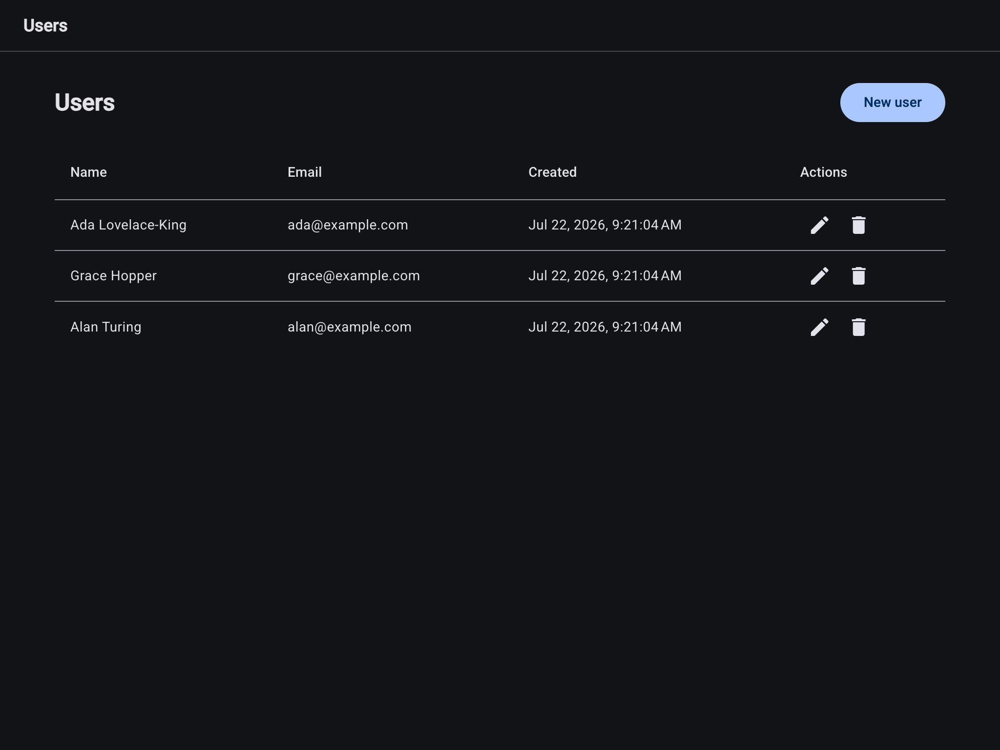

# Spring + Angular User CRUD


A small full-stack demo: a Spring Boot REST API and an Angular (Material) frontend implementing user management — create, list, update, delete. No authentication by design; the focus is clean code, a clear folder structure, and idiomatic use of both frameworks.



## Stack

- **Backend** — Java 21, Spring Boot (Web, Data JPA, Validation, Actuator), H2 in-memory database, springdoc OpenAPI, Maven
- **Frontend** — Angular standalone components with signals and typed reactive forms, Angular Material (M3), bun
- **Ops** — multi-stage Dockerfiles, Docker Compose, GitHub Actions CI

## Project structure

```
backend/
  src/main/java/com/example/usercrud/
    user/                 # feature package: entity, repository, service, controller
    user/dto/             # request/response records with bean validation
    common/exception/     # domain exceptions + RFC 7807 ProblemDetail handler
    config/               # CORS, demo data seeder
  src/test/java/          # service unit tests + @WebMvcTest controller slice tests
frontend/
  src/app/
    core/api/             # typed HTTP client for the users API
    core/interceptors/    # functional interceptor normalizing errors to ApiError
    core/notifications/   # NotificationService — single owner of toasts (top-center)
    features/users/       # user-list page, user-form (create + edit)
    shared/models/        # User model, payload type, ProblemDetail type
```

## Running it

**Docker (one command):**

```sh
docker compose up --build
```

Frontend at `http://localhost:4200` (nginx, proxying `/api` to the backend container).

**Local development:**

```sh
# backend — http://localhost:8080, H2 in-memory, no setup needed
cd backend && mvn spring-boot:run

# frontend — http://localhost:4200, dev-server proxies /api to :8080
cd frontend && bun install && bun start
```

The database is seeded with a few demo users on first start and resets on restart (in-memory).

## API

| Method | Path              | Result                                  |
| ------ | ----------------- | --------------------------------------- |
| GET    | `/api/users`      | `200` list of users                     |
| GET    | `/api/users/{id}` | `200`, or `404`                         |
| POST   | `/api/users`      | `201` + `Location` header, `400`, `409` |
| PUT    | `/api/users/{id}` | `200`, `400`, `404`, `409`              |
| DELETE | `/api/users/{id}` | `204`, or `404`                         |

Request body for POST/PUT:

```json
{ "firstName": "Ada", "lastName": "Lovelace", "email": "ada@example.com" }
```

Errors are [RFC 7807](https://datatracker.ietf.org/doc/html/rfc7807) `application/problem+json` — `400` includes a per-field `errors` map, `409` signals a duplicate email.

- Swagger UI: `http://localhost:8080/swagger-ui.html`
- Health: `http://localhost:8080/actuator/health`

## Tests

```sh
cd backend && mvn test                       # service unit tests + controller slice tests
cd frontend && bun run test -- --watch=false # vitest: API service + component specs
```

CI runs both suites plus the frontend production build on every push.

## Design notes

- Entities never leave the service layer — the API speaks DTOs (Java records) with bean validation on input; business rules (duplicate email, not-found) live in the service and surface as domain exceptions mapped centrally to ProblemDetail responses.
- The Angular side is signals-first: standalone components, `inject()`, `@if`/`@for` control flow, lazy-loaded routes. HTTP errors are normalized once in a functional interceptor, and all toasts go through one `NotificationService`, so components never touch `HttpErrorResponse` or snackbar config.
- CORS origin is configurable via `CORS_ALLOWED_ORIGINS` (defaults to `http://localhost:4200`); in Docker the nginx proxy makes the app same-origin instead.
- Deliberately out of scope to keep the demo small: authentication, pagination, and a persistent database.

## License

[MIT](LICENSE)
